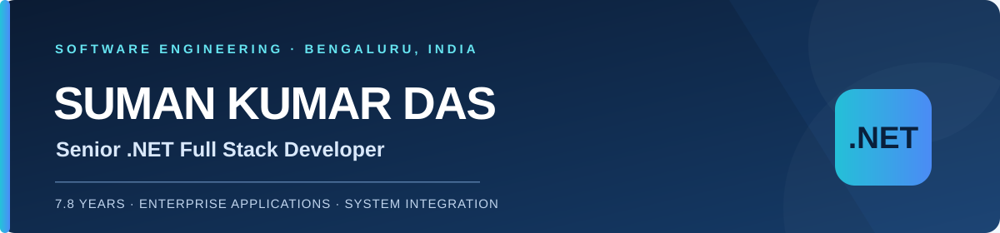

  

  
  
  
  

---

## About

I’m a **Senior .NET Full Stack Developer with 7.8 years of professional experience**, building and supporting enterprise web applications, backend services and business-critical integrations.

My core professional stack is **C#, .NET Framework, ASP.NET, ASP.NET MVC, Web API, WCF/ASMX, ADO.NET and Microsoft SQL Server**. I work across application development, SAP integration, database optimization, production troubleshooting, testing and delivery.

**Present company:** Tata Consultancy Services (TCS) · Bengaluru, India

## Engineering focus

| Enterprise application development | Integration engineering | Database development | Delivery & support |
|---|---|---|---|
| C#, .NET Framework, ASP.NET MVC, Web API | WCF, ASMX, SOAP/REST, SAP BW/ECC integration | SQL Server, T-SQL, stored procedures, query optimization | Azure DevOps, IIS, Git, debugging, UAT and production support |

## Selected work

A few examples from my professional project experience. The portfolio contains the fuller career timeline and project descriptions.

- **MyAssignments · TCS** — Three-tier enterprise application supporting business reporting, with SAP BW/ECC integration and SQL Server development.
- **KONE MES · ITC Infotech** — Manufacturing execution environment using DELMIA Apriso; regression testing, UAT and SQL data validation.
- **Veptas Technology MGLD · CHETU** — C# and ASP.NET modules for a predictive analytics platform, with unit testing and technical design documentation.
- **Government platforms · CSM Technologies** — Application development and maintenance across PHED Bihar, TMIS Odisha and I3MS Odisha.

## Core technology stack

  
  
  
  
  
  
  
  
  
  
  
  

**Also worked with:** VB.NET, WCF, ASMX, ADO.NET, AJAX, IIS, TFS, SVN, SSMS, Jira and ServiceNow.

**Current learning:** React.js, modern frontend development and cloud fundamentals. These are kept separate from my core professional .NET experience.

## Code & portfolio

- [JavaScript practice](https://github.com/sumandfs/Javascript) — fundamentals, examples and coding exercises.
- [Portfolio source](https://github.com/sumandfs/sumankumardas.github.io) — source code for my personal portfolio website.
- [Full professional portfolio](https://sumandfs.github.io/sumankumardas.github.io/) — experience, projects, technology stack and education.

## Connect

I’m interested in senior .NET opportunities focused on enterprise application development, backend engineering, API and system integration, SQL Server and technical ownership.

  <a href="https://www.linkedin.com/in/suman-kumar-das-9866311b6">LinkedIn</a> ·
  <a href="mailto:dassumandas1991@gmail.com">Email</a> ·
  <a href="https://github.com/sumandfs">GitHub</a> ·
  <a href="https://sumandfs.github.io/sumankumardas.github.io/">Portfolio</a>

Build reliable systems · Solve practical problems · Keep learning

