I build and support enterprise web applications using **C#, .NET, ASP.NET, Web API and SQL Server**. My work spans application development, SAP system integration, database programming, deployment support and production troubleshooting.

### What that looks like in practice

- **Application development** — C# and ASP.NET modules in three-tier enterprise applications.
- **System integration** — WCF/ASMX services and SAP BW / SAP ECC data flows.
- **Database development** — SQL Server queries, stored procedures, views and query optimization.
- **Delivery and support** — Azure DevOps builds, IIS deployments, testing, debugging and production support.

 

### Building

| Repository | Status | Description |
|---|---|---|
| **[JavaScript Practice](https://github.com/sumandfs/Javascript)** | `LEARNING` | Hands-on JavaScript examples for variables, data types, type conversion, comparisons and strings. |
| **[Portfolio Website](https://github.com/sumandfs/sumandfs.github.io)** | `PERSONAL` | Responsive portfolio built with HTML, CSS and JavaScript and published through GitHub Pages. |
| **[AI Job Search](https://github.com/sumandfs/ai-job-search)** | `FORK` | A fork of an existing open-source project; original authorship belongs to the upstream project. |

### Enterprise work

- **MyAssignments · TCS** — Three-tier business reporting application integrating SAP BW and SAP ECC through WCF/ASMX services.
- **KONE MES · ITC Infotech** — Regression and UAT support, SQL Server data validation and defect investigation.
- **Veptas Technology MGLD · CHETU** — C# and ASP.NET modules for a predictive analytics platform.
- **PHED Bihar · TMIS Odisha · I3MS Odisha · CSM Technologies** — Development and maintenance of public-sector applications using C#, VB.NET and ASP.NET MVC.

Client source code is proprietary and is not published in these repositories. The summaries above avoid confidential implementation details.

### Activity

**Recent · Last 12 Months**

<picture>
  <source media="(prefers-color-scheme: dark)" srcset="assets/activity/contributions.dark.svg" />
  
</picture>

<picture>
  <source media="(prefers-color-scheme: dark)" srcset="assets/activity/overview.dark.svg" />
  
</picture>

**All Time · Contribution history by year**

<picture>
  <source media="(prefers-color-scheme: dark)" srcset="assets/activity/lifetime.dark.svg" />
  
</picture>

<picture>
  <source media="(prefers-color-scheme: dark)" srcset="assets/activity/composition.dark.svg" />
  
</picture>

*These cards are generated from GitHub contribution data and refreshed automatically each day.*

### Stack

### Languages

---

I approach enterprise application issues by tracing the request across the full execution path — from the ASP.NET entry point and C# business logic through ADO.NET and SQL Server. For integrations, the flow also connects through WCF/ASMX services to SAP BW and SAP ECC.

This graphic is a conceptual view of that application path, not a runtime benchmark or a claim of measured CPU percentages. Actual hot spots are identified from application logs, SQL execution plans and profiler traces.

 

I enjoy solving practical engineering problems, improving existing applications and learning through hands-on development. Feel free to connect through [LinkedIn](https://www.linkedin.com/in/suman-kumar-das-9866311b6) or my [professional portfolio](https://sumandfs.github.io/).
